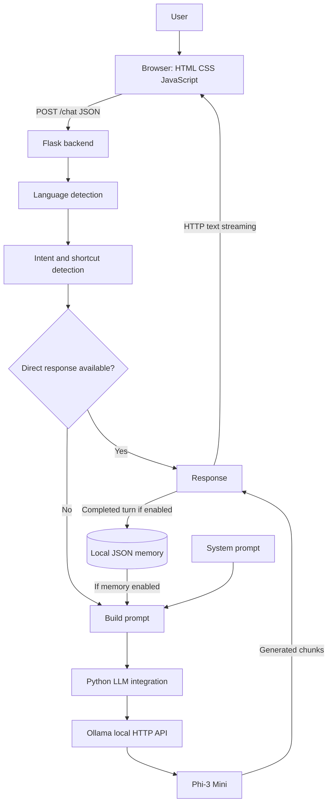
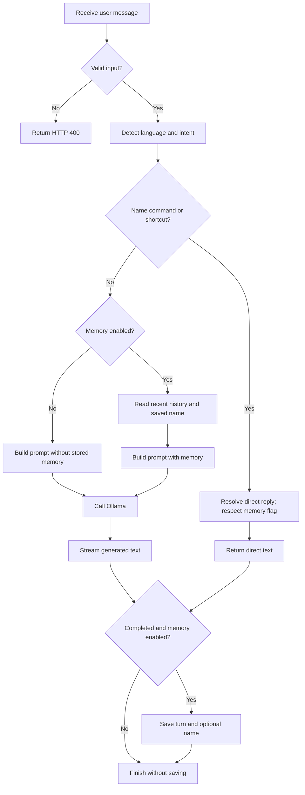
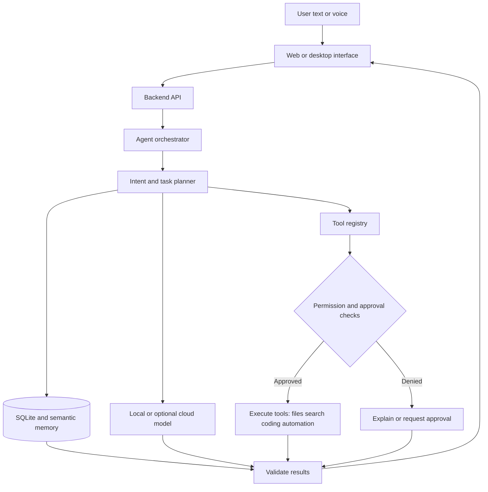

# NeuraXAi — Personal Local AI Assistant

**Developer:** M. Dhanush  
**Domain:** Artificial Intelligence / Generative AI / Software Engineering  
**Existing baseline:** v0.3.0 | **Prepared update:** v0.4.0 (testing pending)  
**Target release:** v1.0.0

## Table of contents

- [Project overview](#project-overview)
- [Objectives](#objectives)
- [Technology stack](#technology-stack)
- [Development process](#development-process)
- [Version history](#version-history)
- [Architecture and flowcharts](#architecture-and-flowcharts)
- [Project structure](#project-structure)
- [Installation and setup](#installation-and-setup)
- [Upgrade from v0.3.0](#upgrade-from-v030)
- [Usage and testing](#usage-and-testing)
- [Memory and API](#memory-and-api)
- [Known limitations](#known-limitations)
- [Development roadmap](#development-roadmap)
- [Security and troubleshooting](#security-and-troubleshooting)

## Project overview

NeuraXAi is a personal, local-first AI assistant built with Python, Flask, HTML, CSS, JavaScript and Ollama. It integrates Microsoft's pre-trained Phi-3 Mini language model to generate conversational responses on the user's computer. Once the dependencies and model are installed, basic conversations do not require a cloud AI API or internet access.

The application combines a web chat interface, HTTP response streaming, language detection, system prompts and local JSON memory. The long-term goal is to evolve this conversational assistant into a permission-controlled AI agent capable of using tools, processing documents and executing productivity workflows.

NeuraXAi is an application built around an existing model, not a newly trained foundation model. Development includes AI-assisted coding, integration, debugging and testing.

## Objectives

- Provide a customizable local AI assistant with English and Telugu support.
- Keep personal memory on the local computer and provide control over its use.
- Reduce dependence on paid cloud AI APIs for basic conversations.
- Learn practical software engineering, backend/frontend integration and AI application development.
- Eventually support document processing, coding, personal productivity and freelance workflows with human verification.

## Technology stack

| Component | Technology | Purpose |
|---|---|---|
| Language | Python | Backend and application logic |
| Web framework | Flask | HTTP routes and streaming responses |
| Frontend | HTML, CSS, JavaScript | Chat interface and interaction |
| Local runtime | Ollama | Run pre-trained models locally |
| Default model | `phi3:mini` | Natural language generation |
| HTTP client | Requests | Communicate with Ollama |
| Storage | JSON | Personal facts and chat history |
| Testing | Python unittest | Backend regression tests in v0.4.0 |
| IDE | Visual Studio Code | Development and debugging |

## Development process

1. Define the requirements for a personal local assistant.
2. Set up Python, VS Code and Ollama.
3. Download and run Phi-3 Mini; integrate its local HTTP API using Python.
4. Create conversational logic and system instructions for the NeuraXAi identity.
5. Implement JSON-based personal facts and conversation history.
6. Add English/Telugu language detection and response formatting instructions.
7. Build the Flask backend and browser-based chat interface.
8. Stream model output to the browser; add scrolling, stop and code-copy controls.
9. Review the v0.3.0 source and identify privacy, reliability and usability defects.
10. Prepare the v0.4.0 stability update with modular language/intent logic and regression tests.
11. Validate the update on the target laptop before declaring it stable.
12. Add advanced memory, tools, retrieval and automation in subsequent releases.

## Version history

The v0.1.0 and v0.2.0 entries are reconstructed development milestones based on the earlier project progression, not verified historical Git tags or release snapshots. The exact feature introduction dates are unavailable. v0.3.0 is the supplied baseline source; v0.4.0 is the prepared update reviewed for this documentation.

### v0.1.0 — Foundation and local AI (reconstructed)

- Python project setup and basic command-line conversation workflow.
- Ollama installation and local model integration.
- Basic user input and generated responses.
- Initial application structure and assistant behavior.

### v0.2.0 — Memory and conversational behavior (reconstructed)

- Early personal information storage and retrieval.
- Conversation memory and greeting shortcuts.
- Early English/Telugu response handling and prompt customization.
- Improvements to conversational behavior before the web-based baseline.

### v0.3.0 — Web-based local assistant (existing baseline)

- Flask `/` and `/chat` routes; HTML/CSS/JavaScript chat interface.
- Ollama `/api/generate` integration with Phi-3 Mini and streaming.
- JSON facts and recent conversation history; name capture and retrieval.
- Telugu Unicode detection; English as the default.
- Hi/hello/hey shortcuts and custom system prompt.
- Bullet/paragraph instructions and a default three-line response limit.
- Auto-growing input, automatic scrolling, stop button, basic code formatting and copy.
- Partial memory control: backend accepts a memory flag, but the original UI has no toggle and the name lookup bypasses the flag.

### v0.4.0 — Intelligence and stability (prepared; testing pending)

| Area | Change from v0.3.0 |
|---|---|
| Memory privacy | Name and history retrieval and saving respect the per-request memory flag; UI checkbox added |
| Name extraction | Explicit name phrases support multi-word names; generic `I am` no longer triggers storage |
| Storage | Project-relative absolute path, structure validation, process-local lock and atomic file replacement |
| Language | Separate `language.py`; Telugu Unicode and keyword-based Roman Telugu detection |
| Intent | Separate `intent.py`; greetings, thanks, farewell, identity and time-of-day greetings |
| Prompts | More flexible detail and formatting instructions; uncertainty guidance |
| Ollama | Configurable model, HTTP status checks, connect/read timeouts and stream error detection |
| Backend | JSON input validation, request size limit, local binding and debug disabled |
| Frontend | Safer DOM text rendering, fenced code copy, improved stop state and error display |
| Tests | Five unittest cases covering homepage, memory-off lookup, name extraction, invalid input and mocked streaming |
| Dependencies | Flask and Requests version ranges; README and gitignore included |

The update has not been confirmed on the target laptop. A backend test attempt in the documentation environment was blocked by missing Flask. Live Ollama behavior and browser interaction remain unverified.

### Feature comparison

| Feature | v0.3.0 | v0.4.0 source |
|---|---|---|
| Local chat and streaming | Implemented | Retained |
| Name memory | Partial | Improved |
| Memory toggle | Backend flag only | UI and backend |
| Roman Telugu | Not supported | Heuristic support |
| Greetings and identity | Basic | Expanded shortcuts |
| Error handling | Limited | Improved |
| Code rendering | Basic HTML formatter | Safe text and fenced code rendering |
| General Markdown rendering | Basic formatting | Plain text outside code fences |
| Automated tests | Not supplied | Five tests supplied |
| PDF/Excel, RAG, web search, voice, agents | Not implemented | Planned |

## Architecture and flowcharts

### System architecture



### Request lifecycle (v0.4.0)



For example, when the user asks `Explain Python in bullet points`, JavaScript sends the message to Flask. The backend detects the language, checks for shortcuts, retrieves recent memory if enabled, and builds a prompt. Ollama generates text, Flask streams it to the browser, and the completed turn is saved if memory is enabled.

## Project structure

```text
Local_AI_Agent/
├── app.py
├── requirements.txt
├── README.md
├── .gitignore                # v0.4.0
├── core/
│   ├── __init__.py
│   ├── llm.py
│   ├── memory.py
│   ├── prompt.py
│   ├── language.py           # v0.4.0
│   └── intent.py             # v0.4.0
├── data/
│   └── memory.json           # local runtime data; not distributed
├── web/
│   ├── static/
│   │   ├── app.js
│   │   └── style.css
│   └── templates/
│       └── index.html
└── tests/
    └── test_app.py           # v0.4.0
```

| File | Responsibility |
|---|---|
| `app.py` | Flask routes, request validation, orchestration and streaming |
| `core/llm.py` | Ollama API client |
| `core/memory.py` | Read and write facts and conversation history |
| `core/prompt.py` | Assistant identity and behavioral instructions |
| `core/language.py` | Language detection |
| `core/intent.py` | Name extraction and deterministic replies |
| `web/templates/index.html` | Chat page and controls |
| `web/static/app.js` | HTTP requests, rendering, scrolling, stop and copy |
| `web/static/style.css` | Visual layout |
| `tests/test_app.py` | Backend tests |

Python generates `__pycache__` automatically; do not edit or commit it.

## Installation and setup

### Prerequisites

- Python 3.10+ for the updated project (3.12 recommended).
- Ollama installed from <https://ollama.com/>.
- Sufficient RAM and disk space for the local model; performance depends on hardware.
- Internet access for initial downloads.

### 1. Open the project folder

In VS Code, select **File → Open Folder**, then open the extracted project directory. Open the integrated terminal.

```powershell
python --version
ollama --version
```

### 2. Create a virtual environment (Windows PowerShell)

```powershell
python -m venv .venv
.\.venv\Scripts\Activate.ps1
python -m pip install --upgrade pip
python -m pip install -r requirements.txt
```

If activation is blocked, use the environment's interpreter directly rather than changing system security policy:

```powershell
.\.venv\Scripts\python.exe -m pip install -r requirements.txt
.\.venv\Scripts\python.exe app.py
```

For Windows Command Prompt, activate with `.venv\Scripts\activate.bat`. For Linux/macOS, use `python3 -m venv .venv` followed by `source .venv/bin/activate`.

### 3. Download and verify the model

```bash
ollama pull phi3:mini
ollama list
ollama run phi3:mini
```

Enter a test prompt, then type `/bye` to exit the interactive model session. If the Ollama service is not already running, start it in a separate terminal:

```bash
ollama serve
```

Do not start a second server if Ollama is already listening on port 11434.

### 4. Run NeuraXAi

```bash
python app.py
```

Open <http://127.0.0.1:5000> in a browser. Keep the Flask terminal and Ollama service running. Press `Ctrl+C` in the Flask terminal to stop the application.

### 5. Optional model and runtime configuration

Set environment variables before starting Flask. NeuraXAi reads them at startup and logs a warning when an invalid value falls back to its default.

| Variable | Default | Meaning |
|---|---|---|
| `NEURAXAI_MODEL` | `phi3:mini` | Installed Ollama model tag |
| `NEURAXAI_OLLAMA_URL` | `http://localhost:11434` | Base URL for Ollama |
| `NEURAXAI_CONNECT_TIMEOUT` | `3.0` | Positive connection timeout in seconds, used starting in Task 6 |
| `NEURAXAI_READ_TIMEOUT` | `120.0` | Positive read timeout in seconds, used starting in Task 6 |
| `NEURAXAI_TEMPERATURE` | `0.7` | Sampling temperature from 0 to 2 inclusive |
| `NEURAXAI_MAX_MESSAGE_CHARS` | `4000` | Positive message length limit in characters, used starting in Task 7 |
| `NEURAXAI_DEBUG` | `False` | Flask debug flag, used starting in Task 7. Accepts `1`, `true`, or `yes` for ON and `0`, `false`, or `no` for OFF |
| `NEURAXAI_DATA_DIR` | `<project root>/data` | Directory for memory storage. Relative paths resolve against the project root |

```powershell
$env:NEURAXAI_MODEL = "qwen3.5:4b"; python app.py
```

## Upgrade from v0.3.0

1. Stop the old Flask application.
2. Back up the entire existing `Local_AI_Agent` folder, including `data/memory.json`.
3. Extract the v0.4.0 ZIP into a separate directory.
4. Copy the existing `data/memory.json` into the new project's `data/` folder. Create the folder if needed. Do not overwrite the old memory with an empty example.
5. Open the new project in VS Code and install its dependencies using a virtual environment.
6. Verify Ollama and the model, run the automated tests, then start Flask.
7. Complete the manual test checklist before switching permanently to the new version.

## Usage and testing

### Example prompts

| Prompt | Expected behavior in v0.4.0 |
|---|---|
| `Hello` | Direct greeting |
| `What is your name?` | NeuraXAi identity |
| `My name is Alex Kumar` | Store full name if memory is on |
| `What is my name?` | Retrieve saved name if enabled |
| `I am a student` | Must not overwrite the saved name |
| `Naa peru enti?` | Retrieve name using Roman Telugu shortcut |
| `Python ante enti?` | Request Telugu response; model quality may vary |
| `తెలుగులో AI గురించి చెప్పు` | Request Telugu response |
| `Explain Python in detail` | Request detailed model response |
| `Write Python hello world code` | Generate code; copy control if fenced |
| `Thank you` / `Bye` / `Good night` | Direct conversational response |

### Automated tests

```bash
python -m unittest discover -s tests -v
```

The five supplied tests use Flask's test client and mock selected memory/model operations. They do not establish real Ollama connectivity, browser behavior or full memory persistence correctness.

### Manual acceptance checklist

- [ ] Homepage loads and sends messages.
- [ ] Real Ollama response streams successfully.
- [ ] Full name persists across application restart.
- [ ] Memory OFF prevents name lookup, history retrieval and new writes.
- [ ] Memory ON restores access to previously saved data.
- [ ] English, Telugu and Roman Telugu examples behave acceptably.
- [ ] Stop button cancels browser generation and allows a subsequent request.
- [ ] Code copy works; HTML-like model output is displayed safely.
- [ ] Ollama offline and invalid model errors are visible.
- [ ] Existing memory survives the upgrade.
- [ ] Automated tests pass on the target environment.

## Memory and API

Memory uses a local JSON file with a `facts` object and `history` array. Example only:

```json
{
  "facts": {"user_name": "Alex Kumar"},
  "history": [
    {"role": "user", "content": "Hello"},
    {"role": "assistant", "content": "Hello! How can I help you?"}
  ]
}
```

The backend includes up to ten recent valid history entries in its prompt, along with the saved name in v0.4.0. This is not semantic retrieval or model training. Memory OFF applies to the submitted request and does not delete existing memory. The checkbox defaults to ON when the page reloads. The memory file is not encrypted.

| Endpoint | Method | Purpose |
|---|---|---|
| `/` | GET | Render chat page |
| `/chat` | POST | Accept JSON message and memory flag; stream plain text |
| `http://127.0.0.1:11434/api/generate` | POST | Local Ollama model generation |

Test the Flask endpoint in a separate PowerShell terminal while the app is running:

```powershell
Invoke-RestMethod -Uri http://127.0.0.1:5000/chat -Method Post -ContentType 'application/json' -Body '{"message":"Hello","memory":false}'
```

Linux/macOS example:

```bash
curl -N http://127.0.0.1:5000/chat -H 'Content-Type: application/json' -d '{"message":"Hello","memory":false}'
```

## Known limitations

- Phi-3 Mini can generate inaccurate answers and may not follow every language or formatting instruction.
- Roman Telugu detection is keyword-based, not a trained language classifier. Name extraction is heuristic and may misinterpret ambiguous phrases.
- Browser Stop aborts the fetch; immediate cancellation of model computation is not guaranteed.
- General Markdown rendering outside fenced code blocks is not implemented in the update.
- JSON history grows over time; only recent entries are included in prompts. No chat sessions, semantic retrieval or multi-user isolation exist yet.
- File locking is process-local; the storage design is intended for a single local application process.
- No live web search, document upload, PDF/Excel tools, voice, tool execution or autonomous planning is implemented yet.
- No authentication or production deployment configuration is supplied. Keep the service on localhost.

## Development roadmap

The following stages and version numbers are proposed planning milestones, not commitments or measured completion percentages.

| Stage | Version | Scope | Status |
|---|---|---|---|
| 1 | v0.1.0 | Foundation | Reconstructed milestone |
| 2 | v0.1–0.2 | Local LLM integration | Implemented in baseline |
| 3 | v0.3.0 | Web UI and basic memory | Baseline implemented |
| 4 | v0.4.0 | Intelligence and stability | Update prepared; validation pending |
| 5 | v0.5.0 | Advanced memory, SQLite and chat sessions | Planned |
| 6 | v0.6.0 | Tool registry, calculator, date/time, PDF/Excel | Planned |
| 7 | v0.7.0 | Document intelligence and RAG | Planned |
| 8 | v0.8.0 | Live web search and optional cloud models | Planned |
| 9 | v0.9.0 | Coding and freelance productivity | Planned |
| 10 | v0.10.0 | Voice and approved desktop actions | Planned |
| 11 | v0.11.0 | Agent planning and automation | Planned |
| 12 | v1.0.0 | Security, testing, optimization and packaging | Planned |

### Twenty major improvement workstreams

| # | Improvement | Status |
|---|---|---|
| 1 | Bug fixes and error handling | Initial update prepared |
| 2 | Advanced language detection | Initial heuristic prepared |
| 3 | Intent detection | Initial shortcuts prepared |
| 4 | Dynamic response instructions | Initial update prepared |
| 5 | Editable personal facts and profiles | Planned |
| 6 | SQLite and chat sessions | Planned |
| 7 | Semantic memory and summarization | Planned |
| 8 | Tool calling and permission registry | Planned |
| 9 | PDF, CSV and Excel processing | Planned |
| 10 | Document upload and analysis | Planned |
| 11 | Retrieval-augmented generation (RAG) | Planned |
| 12 | Live internet search | Planned |
| 13 | Optional hybrid local/cloud AI | Planned |
| 14 | Coding and debugging assistant | Planned |
| 15 | Invoice extraction and freelance workflows | Planned |
| 16 | Speech recognition and synthesis | Planned |
| 17 | Approved desktop actions | Planned |
| 18 | Multi-step planning | Planned |
| 19 | Scheduled automation and human approval | Planned |
| 20 | Production hardening and packaging | Planned |

### Proposed future agent architecture



The immediate priority is to validate v0.4.0. Then develop advanced memory before adding tools. Freelance use should begin only after relevant file-processing features are implemented, tested against representative inputs, and reviewed for accuracy and client data privacy.

## Security and troubleshooting

| Problem | Action |
|---|---|
| `ModuleNotFoundError: flask` | Activate the correct virtual environment and run `python -m pip install -r requirements.txt` |
| Ollama connection refused | Chat displays `Ollama is not reachable at <configured URL>. Start Ollama and try again.` Start the Ollama application or run `ollama serve`, then resend the message. |
| Model not found | Run `ollama list` and `ollama pull phi3:mini` |
| Port 5000 already in use | Stop the previous Flask process before starting the new one |
| Invalid memory file | Back up the file and restore valid JSON; do not silently erase history |
| Slow responses | Check available RAM, CPU/GPU load and model size |
| Browser displays old assets | Refresh the page or use Ctrl+F5 |

Keep `data/memory.json`, credentials, `.venv/` and `__pycache__/` out of Git. Do not expose Flask or Ollama to the public internet without appropriate authentication and deployment security. Review AI-generated outputs before relying on them. Do not give future tools unrestricted filesystem or shell access.

### Optional Git workflow

After reviewing `.gitignore` and confirming no private data will be committed:

```bash
git init
git status --short
git add .
git diff --cached --stat
git commit -m "Document NeuraXAi v0.4.0 stability update"
```

Create a release tag only after validating the release. Do not fabricate historical tags for reconstructed milestones.

## Final project goal

NeuraXAi aims to become a reliable, customizable personal AI agent that can understand instructions, remember useful information, select approved tools, validate outputs and assist with everyday productivity. The current implementation is a local conversational assistant; autonomous task execution remains a future goal.

## Credits and licensing

NeuraXAi application development: M. Dhanush, with AI-assisted development support. Phi-3 is a Microsoft pre-trained model; Ollama provides the local runtime. Review the respective third-party licenses before redistribution. No project license has been specified yet.
